# Placement Management System

A **Python + MySQL** based console application to manage the complete college placement process — students, companies, placement drives, applications, placements, and reports — through a simple menu-driven interface.

---

## Table of Contents

- [Overview](#overview)
- [Technologies Used](#technologies-used)
- [Features](#features)
- [Project Structure](#project-structure)
- [Database Structure](#database-structure)
- [Setup & Installation](#setup--installation)
- [How to Run](#how-to-run)
- [Working Flow](#working-flow)
- [Screenshots](#screenshots)
- [Error Handling](#error-handling)
- [Concepts Used](#concepts-used)
- [CRUD Operations](#crud-operations)
- [Author](#author)

---

## Overview

The Placement Management System digitizes the manual placement process of a college. It lets a placement cell:

- Register and manage student and company records
- Create and track placement drives
- Handle student applications and their statuses
- Record final placements
- Generate reports for students, companies, drives, and applications

---

## Technologies Used

- **Python** — core application logic
- **MySQL** — relational database
- **PyMySQL** — Python–MySQL connector

---

## Features

### 1. Student Management
- Add student
- View students
- Search student
- Update student
- Delete student

### 2. Company Management
- Add company
- View companies
- Search company
- Update company
- Delete company

### 3. Placement Drive Management
- Add placement drive
- View placement drives
- Search placement drive
- Update placement drive
- Delete placement drive
- Check student eligibility

### 4. Application Management
- Apply for a placement drive
- View applications
- Search student applications
- Update application status
- Delete application

### 5. Placement Management
- Add placement
- View placements
- Search placement
- Update placement status
- Delete placement

### 6. Reports
- Student report
- Placement report
- Application report
- Company report

---

## Project Structure

```
Placement_Management_System/
│
├── main.py
├── database.py
├── students.py
├── companies.py
├── drives.py
├── applications.py
├── placements.py
├── reports.py
├── screenshots/
│   ├── use_case_diagram.png
│   ├── DFD_Level_0_.png
│   ├── System_Flowchart.png
│   ├── SQL_Table_Structure.png
│   ├── view_students_.png
│   ├── view_companies_.png
│   ├── view_placement_drives_.png
│   ├── view_applications_.png
│   ├── view_placements_.png
│   ├── add_company_.png
│   ├── add_placement_drive.png
│   ├── add_placement_.png
│   ├── application_management.png
│   ├── student_reports_.png
│   ├── placement_report_.png
│   ├── delete_student_data_.png
│   └── exit_.png
├── README.md
└── requirements.txt
```

> **Note:** Make sure a `screenshots/` folder exists in the project root containing exactly these files (file names must match, including trailing underscores) for the images in this README to render correctly on GitHub.

---

## Database Structure

The project uses a MySQL database named `placement_management`, containing the following tables:

- `students`
- `companies`
- `drives`
- `applications`
- `placements`

### Students Table
| Field | Description |
|---|---|
| Student ID | Primary key |
| Name | Student's full name |
| Roll Number | College roll number |
| Email | Contact email |
| Phone | Contact number |
| Branch | Academic branch |
| CGPA | Cumulative GPA |
| Graduation Year | Year of graduation |

### Companies Table
| Field | Description |
|---|---|
| Company ID | Primary key |
| Company Name | Name of the company |
| Location | Company location |
| Job Role | Role offered |
| Package | Salary package offered |

### Drives Table
| Field | Description |
|---|---|
| Drive ID | Primary key |
| Company ID | Foreign key → Companies |
| Eligibility CGPA | Minimum CGPA required |
| Eligibility Branch | Eligible branch(es) |
| Drive Date | Date of the drive |

### Applications Table
| Field | Description |
|---|---|
| Application ID | Primary key |
| Student ID | Foreign key → Students |
| Drive ID | Foreign key → Drives |
| Application Date | Date applied |
| Application Status | Status of the application |

### Placements Table
| Field | Description |
|---|---|
| Placement ID | Primary key |
| Student ID | Foreign key → Students |
| Company ID | Foreign key → Companies |
| Package | Final package offered |
| Joining Date | Date of joining |
| Placement Status | Status of the placement |

The SQL schema is also shown visually below:

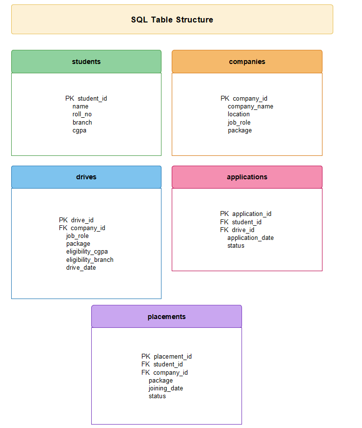

---

## Setup & Installation

Follow these steps exactly — no prior context about the project is assumed.

### Step 1: Prerequisites
Make sure the following are installed on your system:
- **Python 3.x** — [Download here](https://www.python.org/downloads/)
- **MySQL Server** — [Download here](https://dev.mysql.com/downloads/mysql/)
- **pip** (comes bundled with Python)

### Step 2: Clone the repository
```bash
git clone https://github.com/{your-github-username}/{your-repo-name}.git
cd {your-repo-name}
```

### Step 3: Install dependencies
```bash
pip install -r requirements.txt
```
Or, if `requirements.txt` only contains PyMySQL:
```bash
pip install pymysql
```

### Step 4: Configure the MySQL connection
Open `database.py` and update the connection details to match your local MySQL setup:

```python
host = "localhost"
user = "root"
password = "your_password"
```

> The program automatically creates the `placement_management` database and all required tables the first time `database.py` / `main.py` is run — you do not need to create them manually.

### Step 5: Start MySQL
Make sure your MySQL server is running before you launch the application (e.g., via MySQL Workbench, XAMPP, or the `mysql` service on your OS).

---

## How to Run

### Step 1: Open the project folder
Open the project folder in VS Code or any Python IDE / terminal.

### Step 2: Ensure PyMySQL is installed
```bash
pip install pymysql
```

### Step 3: Run the main program
```bash
python main.py
```

### Step 4: Use the Main Menu
```
1. Student Management
2. Company Management
3. Placement Drive Management
4. Application Management
5. Placement Management
6. Reports
7. Exit
```

---

## Working Flow

```
Student Registration
        ↓
Company Registration
        ↓
Placement Drive Creation
        ↓
Student Eligibility Check
        ↓
Student Applies for Drive
        ↓
Application Status Updated
        ↓
Student Selected
        ↓
Placement Added
        ↓
Reports Generated
```

This flow is also represented as a use-case diagram and system flowchart below.

---

## Screenshots

### System Design

| Use Case Diagram | Data Flow Diagram (Level 0) |
|---|---|
| 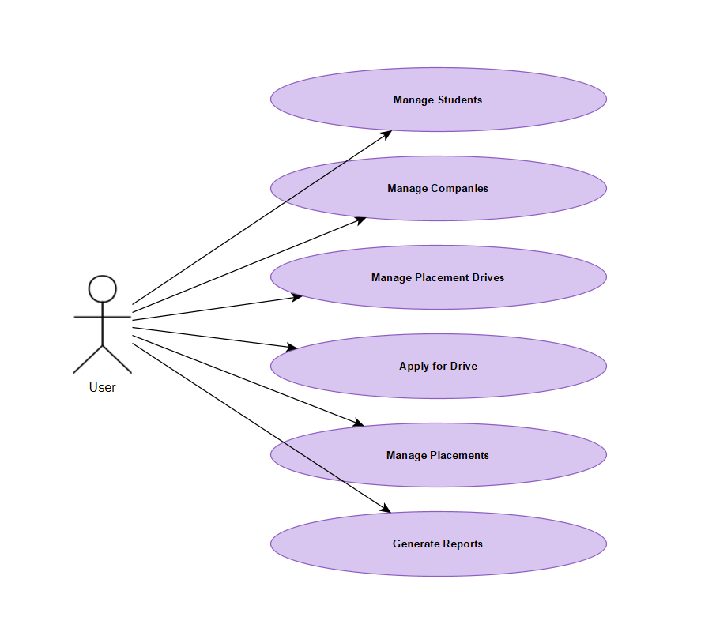 |  |

**System Flowchart**


### Application in Action

#### Student Management
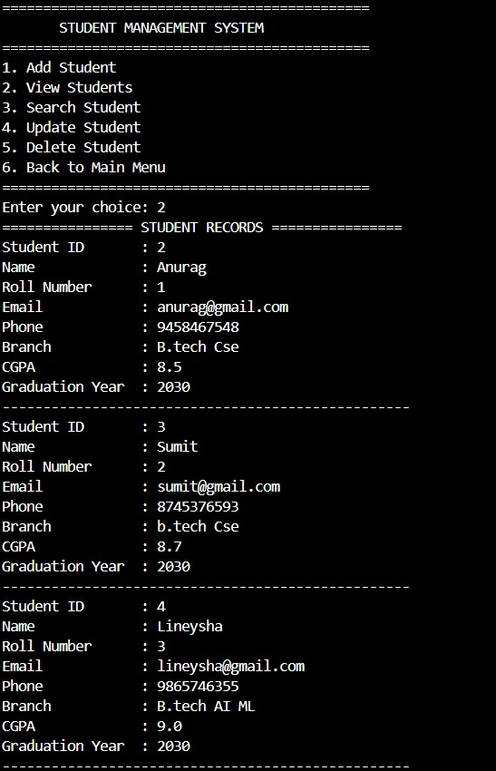
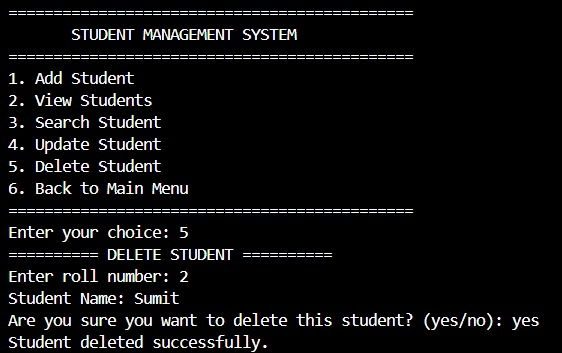

#### Company Management
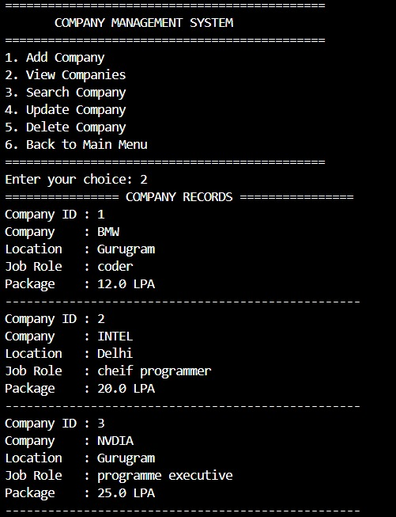


#### Placement Drive Management
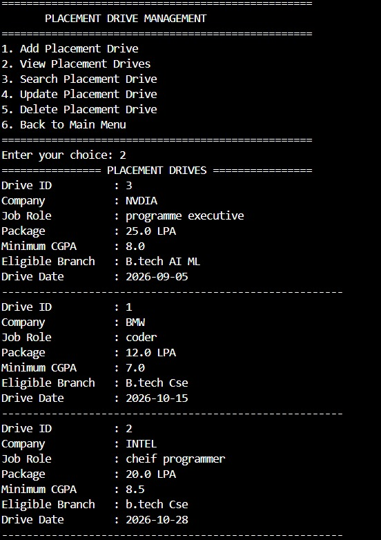
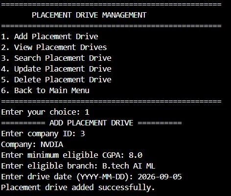

#### Application Management
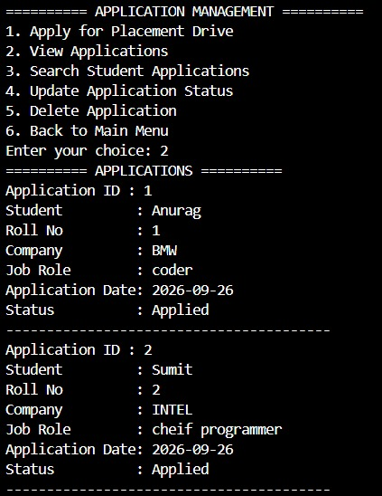
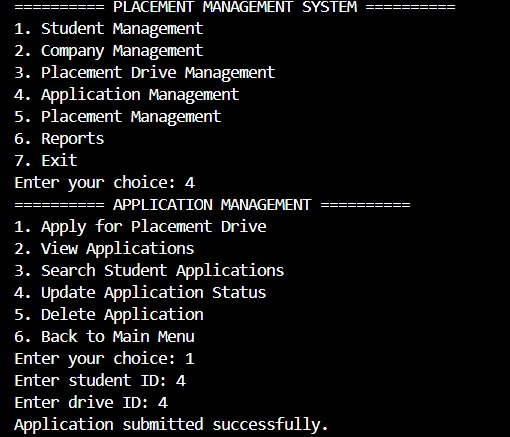

#### Placement Management
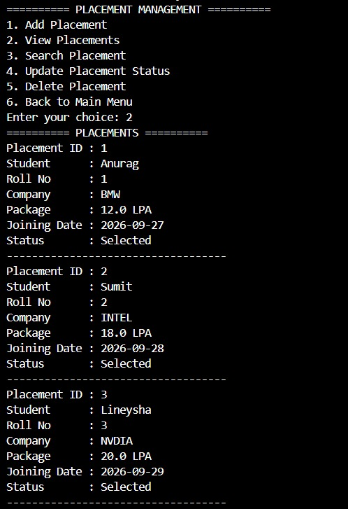
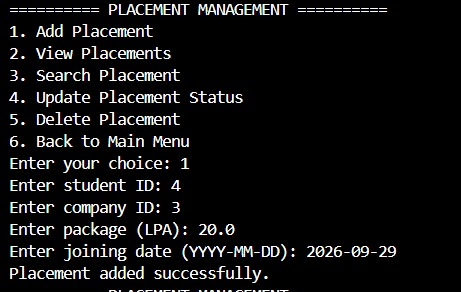

#### Reports
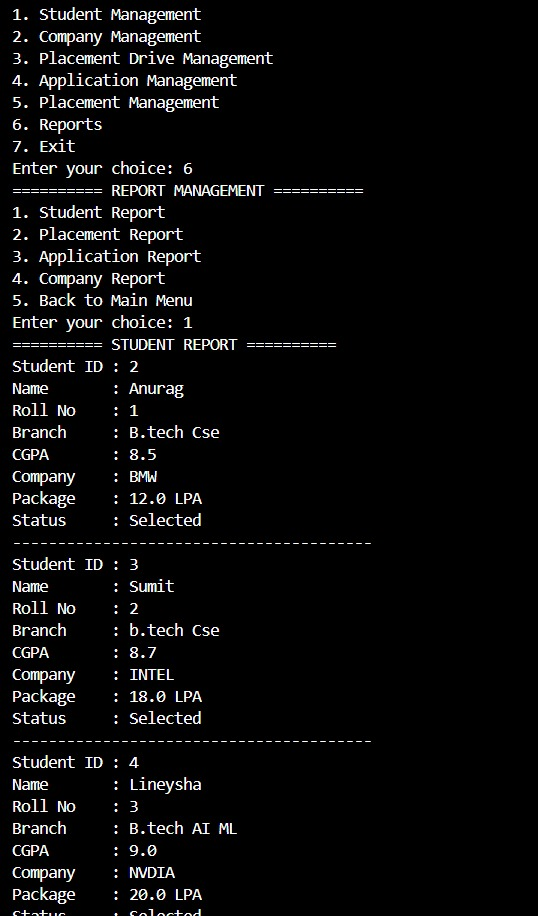
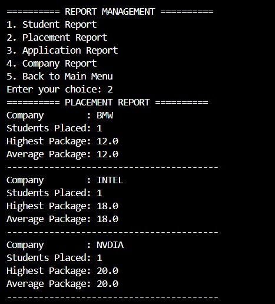

#### Exit Menu
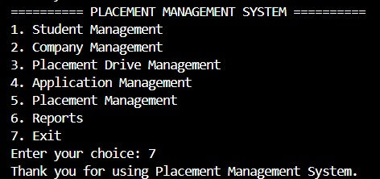


---

## Error Handling

The project includes basic error handling for:
- Invalid input
- Invalid numbers
- Invalid dates
- Invalid menu choices
- Duplicate student applications
- Duplicate placements
- Non-existing students
- Non-existing companies
- Non-existing placement drives
- MySQL connection errors
- MySQL database errors

---

## Concepts Used

- Python functions
- Modules
- Conditional statements
- Loops
- Exception handling
- Input validation
- MySQL database connectivity
- CRUD operations
- SQL queries
- Primary keys
- Foreign keys
- JOIN operations
- Searching
- Sorting
- Database reports
- Menu-driven programming

---

## CRUD Operations

| Operation | Action |
|---|---|
| **Create** | Add records |
| **Read** | View and search records |
| **Update** | Modify records |
| **Delete** | Remove records |

---

## GitHub Repository

Repository submission requirements:
- The repository **must be public** before submission — private repositories will not be accessible during evaluation.
- Submit the **repository root URL** in the following format:
  ```
  https://github.com/{github-username}/{repo-name}
  ```
- Do **not** submit a tree/blob URL (e.g., containing `/tree/main/` or `/blob/`) — this results in automatic rejection.

---

## Author

**Hardik Yadav**
BTech CSE Core
VIT Bhopal
